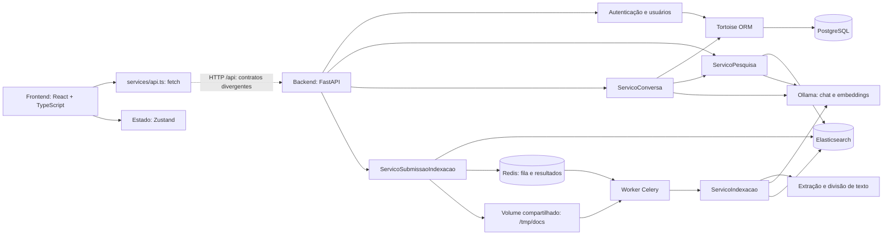
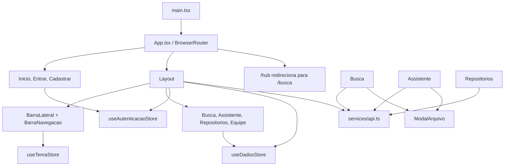
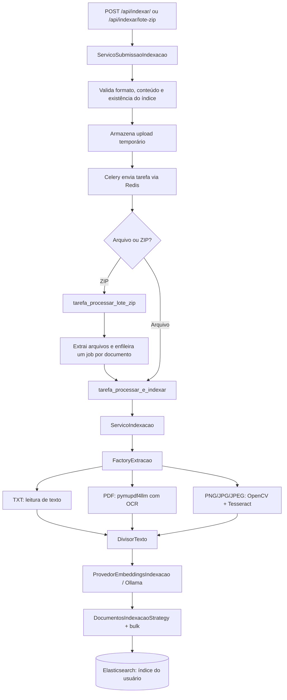
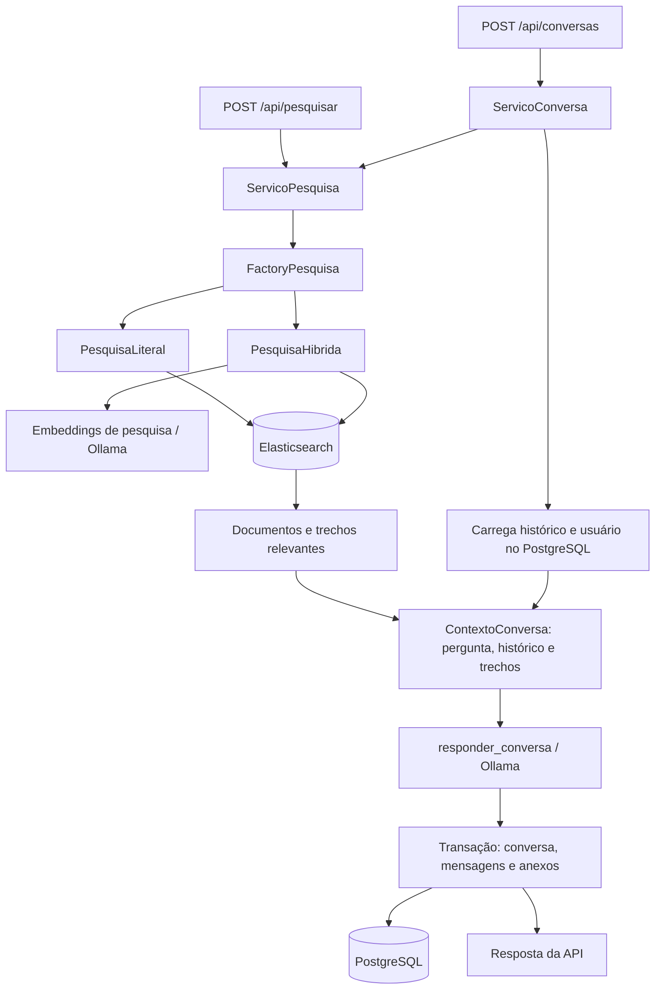

# Grafo do Fluidocs

Mapa elaborado por leitura estática do código em 9 de setembro de 2026. Este arquivo é um mapa de arquitetura em Mermaid; não foi produzido pela ferramenta Graphify. As relações representam chamadas e dependências declaradas, sem validação dos serviços em execução.

## Visão geral

As setas contínuas indicam dependências presentes no código. A seta pontilhada entre frontend e API indica chamadas HTTP cujos contratos divergem nesta versão. Os clientes Ollama de conversa, pesquisa e indexação têm hosts configuráveis; o diagrama os agrupa por tecnologia, sem pressupor um único servidor.

Fontes: `docker-compose.yml`, `backend/src/backend/config/__init__.py`, `backend/src/backend/db/conexao.py`, `backend/src/backend/api/services/`, `backend/src/backend/workers/` e `frontend/src/services/api.ts`.

## Frontend

`Busca`, `Assistente` e `Repositorios` são detalhamentos do nó de páginas. `Equipe` usa o estado local em `useDadosStore`. `Entrar` e `Cadastrar` atualizam `useAutenticacaoStore`; não há chamada de autenticação HTTP nessas telas. O arquivo `pages/Hub.tsx` existe, mas não é importado pelo roteador atual.

Fontes: `frontend/src/App.tsx`, `frontend/src/components/Layout.tsx`, `frontend/src/pages/`, `frontend/src/store/` e `frontend/src/components/BarraNavegacao.tsx`.

## Indexação de documentos

O worker remove os arquivos temporários em blocos `finally`. A conclusão da tarefa ZIP significa que os jobs individuais foram criados; os documentos ainda podem estar em processamento. Redis está configurado como broker e backend de resultados do Celery.

Fontes: `backend/src/backend/api/routes/backoffice/rotas_indexacao.py`, `backend/src/backend/api/services/indexacao/`, `backend/src/backend/workers/`, `backend/src/backend/domain/extracao/` e `backend/src/backend/domain/indices/indexacao/strategy/`.

## Pesquisa e conversa

A pesquisa também pode retornar seus documentos diretamente ao cliente, sem passar pela conversa. `FactoryPesquisa` implementa as opções literal e híbrida. A conversa executa a inferência antes da transação e verifica concorrência antes de salvar novas mensagens.

Fontes: `backend/src/backend/api/services/pesquisa.py`, `backend/src/backend/api/services/conversa.py`, `backend/src/backend/domain/pesquisa/factory_pesquisa.py`, `backend/src/backend/domain/conversa/resposta.py` e `backend/src/backend/api/dependencies/conversa.py`.

## Diferenças de integração encontradas

Todos os caminhos abaixo incluem o prefixo padrão `/api`. O frontend permite substituir a URL base por configuração; esta comparação considera o backend deste repositório.

| Operação | Chamada declarada no frontend | Rota declarada no backend |
| --- | --- | --- |
| Pesquisa | `GET /api/pesquisa/` com query string | `POST /api/pesquisar` com corpo validado por `PesquisaRequest` |
| Listar conversas | `GET /api/agente/conversas/` | `GET /api/conversas` |
| Criar conversa vazia | `POST /api/agente/conversas/` | `POST /api/conversas/nova` |
| Enviar pergunta | `POST /api/agente/conversas/{id}/conversar` | `POST /api/conversas` |
| Enviar ZIP | `POST /api/repositorios/lote-zip` | `POST /api/indexar/lote-zip` |
| CRUD de repositórios | Chamadas para `/api/repositorios/` e `/api/repositorios/{id}` | Nenhuma rota de repositórios registrada em `build_router()` |
| Login e cadastro | Atualização do estado local nas telas | Rotas de autenticação registradas sob `/api/auth` |

Os formatos de dados também diferem: o adaptador de conversas do frontend espera `historico`, enquanto o detalhe do backend retorna `mensagens`; a pesquisa do frontend usa `id_repositorio`, enquanto o serviço do backend trabalha com `fonte_dados_ids`. A existência das chamadas no frontend não comprova integração funcional com esta API.

Fontes: `frontend/src/services/api.ts`, `frontend/src/pages/Entrar.tsx`, `frontend/src/pages/Cadastrar.tsx`, `backend/src/backend/api/routes/router.py`, `backend/src/backend/api/routes/backoffice/pesquisa_routes.py`, `backend/src/backend/api/routes/backoffice/conversa_routes.py` e `backend/src/backend/api/routes/backoffice/rotas_indexacao.py`.

## Escopo da verificação

As relações foram conferidas nas importações, chamadas de serviço, rotas registradas e configurações do Docker Compose. Este mapa resume os principais componentes; não é um inventário exaustivo de imports. Não foram iniciados containers, executados testes de integração ou alterados contratos da aplicação.
